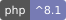

# everrest/watcher

<!-- badges:start -->
[](https://github.com/EverRest/watcher/actions/workflows/ci.yml)
[](https://github.com/EverRest/watcher/releases)




<!-- badges:end -->

Scheduled, model-routed log analysis. Once per window (default 24 h) it reads one service's logs from
Loki or Datadog, groups errors into fingerprinted clusters, decides in plain code which ones deserve
attention, asks Anthropic models to judge only those, and posts one digest to Slack, Telegram or Discord. It is read-only:
it never acts on a service, opens tickets, or stores raw log lines.

**Pipeline at a glance**

```
LogSource -> Reducer -> Redactor -> Selector -> Triage -> Analyze -> (Escalate) -> Dedupe -> Notifier
(per env)    fingerprint  allowlist  anomaly     cheap     mid        strong       StateStore  Slack
             + counters   + normalise rules(code) model     model      model, once
             + vs yesterday
   all steps share: StateStore (fingerprints, verdicts, run records, heartbeat) and the daily budget (spend per call)
```

Every feature has an on/off flag in the config and a `WATCHER_*` environment variable, so one package can run in int, prod and dev with different settings; the master switch `enabled` (`WATCHER_ENABLED`) defaults to off and `environment` (`WATCHER_ENVIRONMENT`) prefixes the state keys (see [docs/configuration.md](docs/configuration.md#feature-flags-spec-012) and [docs/operations.md](docs/operations.md#enabling-and-disabling-per-environment)). Redaction has no switch.

Also: `check`, `status` and `run --dry-run` / `--json` for operating it, a heartbeat for staleness alerts, fleet mode for several services, baselines and similarity grouping to cut noise, and per-feature flags with an `environment` label.

Log hygiene (spec 006): `vendor/bin/watcher hygiene --config=...` reports which log call sites write personal data, which are noisy or badly shaped, which mute/watch rules the history justifies, and what the model costs per day, from counts and masked templates only (see [docs/operations.md](docs/operations.md#log-hygiene-reports-spec-006) and [docs/privacy.md](docs/privacy.md#log-hygiene-reports-spec-006)).

Nothing new to report means zero model calls. The first run only records a baseline. Growth can be measured against the previous window (default), the average of the last N windows, or the median of the same weekday (`baseline.mode`).

## Requirements

- PHP ^8.2. Support matrix: CI tests PHP 8.2 to 8.5. PHP 8.2 security support ends in December 2026; use 8.3 or newer in production. PHP 8.1 support was dropped in 0.1.2.
- Optional: `ext-redis` or `predis/predis` (Redis state, the default driver), `ext-zlib` (compresses large Redis values), `ext-pdo` plus a driver (PDO state).
- A notification channel (Slack incoming webhook, Telegram bot token and chat id, or Discord webhook), an Anthropic API key, read-only credentials for Loki or Datadog.
- Laravel is optional (`illuminate/support`, `illuminate/console` ^10 or ^11; CI tests the oldest and the newest versions Composer resolves, on top of the locked set); the core has no framework dependency. Laravel 10 no longer receives security fixes upstream, prefer 11. Lumen is unmaintained upstream: the adapter has no Lumen-specific test, so treat Lumen as best effort.

## Installation

> **Status: pre-1.0. The API may change between minor versions** (see `CHANGELOG.md`).

```bash
composer require everrest/watcher
```

The Anthropic SDK is optional: the default client (`analysis.client = http`) talks to the API over Guzzle. Only the rollback
`analysis.client = sdk` needs `composer require anthropic-ai/sdk`.

Laravel and Lumen: the service provider is auto-discovered (`extra.laravel.providers`); in Lumen register
`Watcher\Laravel\WatcherServiceProvider` by hand in `bootstrap/app.php`. Without a framework use `vendor/bin/watcher`.

## Quick start

1. Copy `config/watcher.example.php` into your service and fill in the environment variables it reads.
   It returns a plain PHP array. Set `enabled` to true (or `WATCHER_ENABLED=1`): the master switch is off by default and a disabled run reports `disabled` and touches nothing.
2. Check the setup (read-only; posts nothing), preview a run, then run it:

   ```bash
   vendor/bin/watcher check --config=path/to/watcher.php        # source, provider auth, models, prices, state, webhooks
   vendor/bin/watcher run --config=path/to/watcher.php --dry-run --estimate   # no model call: groups, tokens, cost
   vendor/bin/watcher run --config=path/to/watcher.php --dry-run              # real model calls, digest printed, nothing posted
   vendor/bin/watcher run --config=path/to/watcher.php          # add --now=2026-10-23T06:00:00Z to run "as of" an instant
   vendor/bin/watcher status --config=path/to/watcher.php       # is the job alive? exit 0 only when ok
   ```

   | Command | Options |
   |---|---|
   | `watcher run` | `--config=<file>` `[--now=<ISO-8601>]` `[--dry-run [--estimate]]` `[--json]` |
   | `watcher check` | `--config=<file>` `[--post-test]` `[--json]` (`--post-test` posts one labelled message per destination) |
   | `watcher status` | `--config=<file>` `[--json]` |
   | `watcher state:get <key>` | `--config=<file>`; read-only debug view, `<key>` is `heartbeat`, `last-snapshot`, `snapshot:<window end>` or `run:<window end>` (strings redacted, cut to 200 characters; exit 1 when nothing is stored) |

   With `--json`, stdout is exactly one JSON line and every human line goes to stderr. A dry run never posts, writes
   state or records spend. Laravel/Lumen: `watcher:run {--now=} {--dry-run} {--estimate} {--json}`, `watcher:check
   {--post-test} {--json}`, `watcher:status {--json}`, `watcher:state-get {key}`.

3. Lumen/Laravel: the service provider (`Watcher\Laravel\WatcherServiceProvider`) registers the
   `watcher:run` command and merges `config/watcher.php`, which reads `WATCHER_*` environment variables.
   Laravel auto-discovers the provider; in Lumen register it with `$app->register(Watcher\Laravel\WatcherServiceProvider::class)`
   in `bootstrap/app.php`. Laravel can publish the
   config with `php artisan vendor:publish --tag=watcher-config`. Then schedule it hourly:

   ```php
   $schedule->command('watcher:run')->hourly();
   ```

<!-- docs:start -->
## Documentation

The README is the overview; the detail lives in [docs/](docs/README.md) (the index). Internal planning documents in
`docs/` (audit, review, brief, roadmap) and the publishing and development guides are excluded from the Composer
archive via `.gitattributes`; they remain in the repository.

| Document | What it covers |
|---|---|
| [docs/README.md](docs/README.md) | Index of every document in `docs/` |
| [docs/smoke-test.md](docs/smoke-test.md) | First live run, step by step |
| [docs/operations.md](docs/operations.md) | Running it: scheduling, alerting, dry run, heartbeat, fleet, troubleshooting |
| [docs/configuration.md](docs/configuration.md) | Every key and environment variable, feature flags |
| [docs/privacy.md](docs/privacy.md) | What leaves the service |
| [docs/development.md](docs/development.md) | Tests, coverage, hooks, supported versions |
| [docs/publishing.md](docs/publishing.md), [docs/repository-settings.md](docs/repository-settings.md) | Release process and GitHub settings |
| [SECURITY.md](SECURITY.md), [CHANGELOG.md](CHANGELOG.md) | Reporting vulnerabilities; release history |
| [docs/roadmap.md](docs/roadmap.md), [docs/brief.md](docs/brief.md) | Planned specs; the original brief |
| [docs/examples/](docs/examples/) | Configs: [single service](docs/examples/smoke.config.php), [Loki](docs/examples/orders-api.loki.config.php), [fleet](docs/examples/watcher-fleet.php) |
| [.specify/memory/constitution.md](.specify/memory/constitution.md) | Principles every change must respect |

Architecture and decisions for the run workflow live in spec 001:
[plan](specs/001-scheduled-log-watch/plan.md), [research](specs/001-scheduled-log-watch/research.md),
[data model](specs/001-scheduled-log-watch/data-model.md) and the
[contracts](specs/001-scheduled-log-watch/contracts/) (configuration, PHP interfaces, analyzer output schema, Slack messages).

### Specs

Development is spec-driven. Status is from [docs/roadmap.md](docs/roadmap.md) and the [changelog](CHANGELOG.md).

| Spec | Topic | Status |
|---|---|---|
| [001](specs/001-scheduled-log-watch/spec.md) | Scheduled log watch | Implemented (live run pending) |
| [002](specs/002-operability-tools/spec.md) | Operability tools | Implemented |
| [003](specs/003-fleet-and-correlation/spec.md) | Fleet and correlation | Implemented |
| [004](specs/004-baselines-and-templates/spec.md) | Baselines and templates | Implemented (backend patterns deferred) |
| [005](specs/005-incident-workflow/spec.md) | Incident workflow | Spec written |
| [006](specs/006-log-hygiene/spec.md) | Log hygiene | Spec written |
| [007](specs/007-code-aware-analysis/spec.md) | Code-aware analysis | Spec written, blocked on a constitution amendment |
| [008](specs/008-kubernetes-events/spec.md) | Kubernetes events | Spec written |
| [009](specs/009-metrics-and-sentry/spec.md) | Metrics and Sentry | Spec written |
| [010](specs/010-api-context/spec.md) | API context | Spec written |
| [011](specs/011-more-notifiers/spec.md) | More notifiers (Telegram, Discord) | Implemented |
| [012](specs/012-feature-flags/spec.md) | Feature flags and environments | Implemented (changelog) |
| [013](specs/013-observability-sink/spec.md) | Observability sink | Spec written |
<!-- docs:end -->

## Configuration

`config/watcher.example.php` is the complete plain-PHP reference: every key with its default and a one-line
comment. `config/watcher.php` is the same surface for Lumen/Laravel, driven by environment variables.
The contract is `specs/001-scheduled-log-watch/contracts/configuration.md`.

Configuration is validated once, before any network call. A bad value throws `InvalidConfig` naming the key
(never the value), and the process exits with code 2. Unknown top-level keys are rejected.
Required: `service`, `schedule.run_at`, a source driver with its credentials, `analysis.api_key`, all three
`analysis.models`, a price for each of those models, a state driver with its settings, `notify.digest.webhook`.

## Log sources

Use **read-only** credentials. The package only issues query requests (enforced by `tests/Unit/ArchitectureTest.php`).

| Driver | Requests | Credential |
|--------|----------|------------|
| `loki` | `GET /loki/api/v1/query`, `GET /loki/api/v1/query_range` | Bearer token or basic auth with query-only rights; optional `X-Scope-OrgID` tenant. `https` is required; plain `http` only with `allow_insecure: true` and a loopback, private-network (RFC 1918) or cluster-local host (see docs/operations.md). `url` may be a Loki base URL or a Grafana datasource proxy URL. |
| `datadog` | `POST /api/v2/logs/analytics/aggregate`, `POST /api/v2/logs/events/search` (read-only queries sent as POST) | API key plus an application key limited to the `logs_read_data` scope. Set `site` (e.g. `datadoghq.eu`). |

`source.stream_tags` selects which logs belong to the service. Only levels at or above `source.read_min_level`
are read as events; lower levels are counted in totals only.

## State

State holds fingerprints, counters, cached verdicts, spend and run records. Every item has an expiry
(`state.retention`, default 30 days; spend and alert markers 2 days, `noise`/`known` verdicts 3 days, heartbeat records 3x retention; see `docs/privacy.md`).

| Driver | Notes |
|--------|-------|
| `redis` | **The default.** Needs `ext-redis` or `predis/predis` (`state.redis.client`: `auto`, `phpredis`, `predis`). Pass `host/port/password/database`, or inject a connected client as `state.redis.instance`. Every key has a TTL; values over `state.redis.compress_min_bytes` (512) are zlib-compressed. |
| `pdo` | Any PDO DSN. The table is **never created implicitly**: run `Watcher\State\PdoStateStore::createTableSql($driver, $table)` once (sqlite, mysql, pgsql) in a migration. |
| `file` | **Single runner only.** No cross-process guarantees; use it for one host or development. In Kubernetes a pod-local directory loses history (`watcher check` warns). |

## Scheduling

The host triggers the command at least hourly. The package decides whether a trigger is the scheduled one: a run
is due from `schedule.run_at` (in `schedule.timezone`) for one hour. Outside that hour the trigger exits 0 at no cost.
Inside it, a lock (`schedule.lock_ttl`) and a per-window run record make the run idempotent: a second trigger in the
same window does nothing, and a failed run leaves no record so the next trigger retries.

## Privacy

Enforced in code, not by the model. The model never redacts and never chooses its own input.

- Only allowlisted fields are sent: level, normalised message template (numbers, ids, emails, tokens, hosts become
  placeholders such as `<N>`, `<ID>`, `<EMAIL>`), error type, at most 5 stack frames, counts and timestamps.
- Clusters smaller than `redaction.min_group_events_for_text` (default 3) send no message text, because small
  clusters are the ones most likely to hold a single person's data.
- Fail closed per field or event: a field that cannot be scanned is dropped, and a line the rules cannot scan becomes `<UNSCANNABLE>` (it never fails the window). A shape no rule recognises is not an error and passes; see the limits in `docs/privacy.md`.
  Add your own patterns with `redaction.extra_patterns`.
- Model output is scrubbed again before it is cached or shown.
- No raw log line is persisted. Field values used by `watch_rules` and `mute` are matched in memory and dropped.

What leaves the service: (1) to Anthropic, the compact payload above plus `service_context` (up to 1000 chars,
written by you); (2) to the notification channel (Slack, Telegram or Discord), the digest (titles, evidence, hypotheses, counts, short fingerprints, cost line) and
failure/budget notices; (3) queries to your log backend. Nothing else is sent anywhere.

## Cost model

Work is routed by tier and each tier has its own model id, token limits and price (no ids in code):

1. **triage** (cheap model): one batched call over the selected candidates; verdict per fingerprint.
2. **analyze** (mid model): only groups triage marked interesting, at most `selection.top_m`.
3. **escalate** (strong model): only for error-or-worse findings with confidence below `analysis.confidence_threshold`,
   once per finding, at most `analysis.escalation_cap` per run.

Selection is deterministic: new fingerprints, groups that grew by `selection.growth_factor`, level at or above
`selection.min_level`, watch-rule matches, plus the top `selection.top_n`; the rest collapse to one summary line.
No candidates means zero model calls; unchanged groups reuse cached verdicts. Inputs over `max_input_tokens` drop
the lowest-priority groups and the digest says so.

`analysis.prices` is required for every model (`[input, output, cache_read, cache_write]`, USD per million tokens).
Spend is metered per call. At `daily_budget_usd` (and optional `daily_token_limit`) the run falls back to triage only
and posts a "budget exhausted" notice. Alerts post at `budget_alert_percents` (default 25/50/75/90), once each per day.
Every digest ends with a cost line: tokens in/out/cached, model per step, approximate cost, spend today.

## Noise control

- `mute`: by fingerprint or matcher (`template`, `error_type`, `field`), optionally until a date. Muted groups never
  reach a model; the digest shows a count.
- `watch_rules`: named matchers that raise a matching group's priority; only the rule name leaves the service. Plain-literal `template` rules and RE2-safe `error_type` rules are also sent to Loki as search filters (Datadog gets only plain-word literals; one pattern it cannot express switches its server-side filter off), so a matching line below `read_min_level` is still read; other rules (non-literal templates, `field`) are matched only on the lines that were read.
- Dedupe: a group already reported is omitted unless it grew again.

## Failures and exit codes

| Code | Meaning |
|------|---------|
| 0 | Success, including "not due", "already done", "locked", baseline and quiet runs |
| 1 | Run failed (source unavailable, analysis failed, delivery failed, internal error) |
| 2 | Invalid configuration, bad arguments or bad `--now` (`--estimate` without `--dry-run`) |

`watcher check` exits 0 when no check failed, 1 otherwise (an invalid config is a failed `config` check). `watcher status`
exits 0 when `ok`, 1 when `stale` or `failed`, 3 when `unknown` (no record, expired record or unreadable store).

Failures are never silent: a source, analysis or internal failure posts a short notice to `notify.notice`
(or the digest destination) and returns 1. If the notice channel itself fails, the host logger (if you pass one to
`Watcher::fromConfig()`) and the exit code carry it. Notices state a reason and never include secrets or values.

## Digest

One message per service per run: a header (service, environment, window), findings grouped by severity
(critical, error, warn, info), then a line for minor/low-confidence findings, remaining groups, muted count, truncation
notices and a cost footer. A finding shows title, event count and trend (`new` or `up from N`), a 12-character
fingerprint, evidence, a hypothesis (always labelled as such), a suggested next step, a `Check:` line saying what to look at to confirm or refute the hypothesis (never reproduction steps) and, when useful, a `Related:` line naming other groups or declared dependencies to look at next. `analysis.advice.enabled=false` turns the last two off and saves their output tokens.

## Several services (fleet)

One job can watch several services, including ones that cannot host the package (no CLI, no scheduler): list them in a
fleet file and run `watcher fleet:run --config=<file|dir>`. Each service keeps its own window, run record, lock and
digest and runs in isolation (one failing service never stops another; the exit code is the worst). A fleet can add a
shared daily cap (`budget`), one combined digest (`digest: combined`), and **correlation**: when a consumer's findings
reference a service that has a new or grown finding in the same window, the consumer's own finding is annotated
`likely caused by the <origin> finding <fingerprint> (hypothesis)` and one additional message names the origin. It is
decided in code from names, placeholders and times; it makes no model call and withholds nothing. See
[docs/examples/watcher-fleet.php](docs/examples/watcher-fleet.php), [operations](docs/operations.md#fleet) and the
[configuration reference](docs/configuration.md#fleet-configuration).

## Known limits

- The Grafana Explore URL shape and the Datadog response shapes are not verified against live systems; sources are
  tested against recorded fixtures only.
- The request format of the built-in Anthropic client (`x-api-key`, structured output) was tested against recorded fixtures only, not the live API.
- At most `source.group_cap` (5000) distinct problem groups are held per run; on a day with more distinct messages the rest
  is grouped as one "other" group per level and the digest says so. Watch-rule matches are exempt up to twice the cap.
- Cluster templates group by word similarity, not exact shape (`grouping.similarity`); two different problems with very similar wording can still share a template, and fingerprints do not depend on it. A name identical in every event of a cluster is not detectable (see `docs/privacy.md`).
- Grouping is bounded: above `grouping.message_cap` distinct messages, or when the comparison budget runs out, the affected groups show no message text and the digest says so. Backend-provided patterns (`grouping.backend_patterns`) are deferred and rejected for now.
- `baseline.mode` `rolling` and `weekday` need enough retained history (`state.retention`); with too little the run falls back to the previous window and the digest says so.
- Field values never leave the service, so `field` matchers can match but cannot be explained to the model.
- Dependencies are read with the service's own log source: `dependencies.<name>.source` (a different backend per
  dependency) is rejected as not available yet. A dependency's lines are read before triage, so a day on which triage
  marks everything noise can still have spent the dependency reads (totals are always one query per dependency).
- A failed alert notice releases its claim, but an alert is only announced again when later spend crosses that
  threshold again or on the next day.
- Loki's server-side filter works per physical line, so stack-trace lines are not returned and frames come from the
  head line of a record; a record that straddles a Loki page boundary stays split.
- Only Slack, Telegram, Discord, Anthropic, Loki, Datadog and the three state drivers exist. There is no remediation and no ticketing.

## Development

```bash
composer install
composer test    # ParaTest (parallel), no network; composer test:serial = plain PHPUnit
composer stan    # PHPStan
composer style   # Pint (--test)
```

Development is spec-driven: `.specify/memory/constitution.md` (principles), `docs/brief.md` (origin),
`specs/001-scheduled-log-watch/` (spec, plan, contracts, quickstart, tasks). A behaviour change starts with a failing
test; a change to what leaves the service extends the privacy corpus (`tests/Fixtures/privacy`).
`tests/Unit/ArchitectureTest.php` guards: no model ids, no consumer names, read-only sources, no framework in the core.
