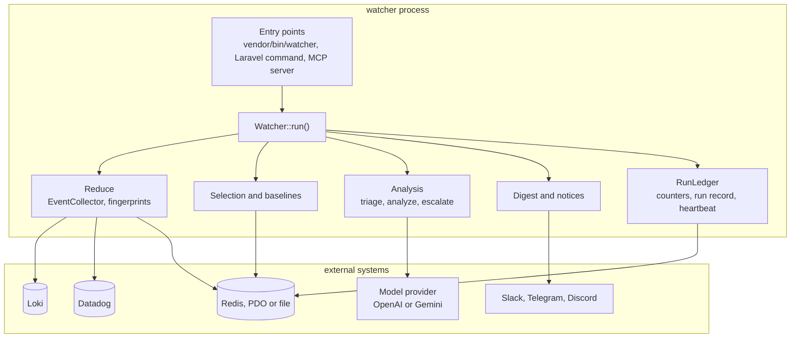

# Architecture

## Overview

Every external system sits behind an interface chosen by config. The only things that leave the process are the
read queries to the log backend, the requests to one model provider per step, and the messages to the notifier.

## Inside `Watcher::run()`

`Watcher` is the single entry point (constructor, `fromConfig`, `run`); a run is split into small collaborators, none of them an interface or a pipeline framework:

- `RunLedger` owns what a run leaves behind: the counters (`RunStats`), the window snapshot, the run record, the heartbeat and the summary data. Writes that must not survive a failed run (dependency snapshots) wait in its buffer until the snapshot is written.
- `Reduce\EventCollector` reads the window from the source and reduces it to problem groups, keeping the event count, the truncation flag and which watch rules and mute entries matched which fingerprint (names and counts only).
- `Watcher::locked()` decides: compare with the previous window, select candidates, then the private `analyze()` (redact, truncate, read dependencies, run the models within their input limit) and `buildDigest()`. `WindowRead` and `Analysis` carry what these steps share.
- `WindowKeys` holds the state keys and lifetimes of one service and window (lock, run record, previous snapshot, reported markers).
